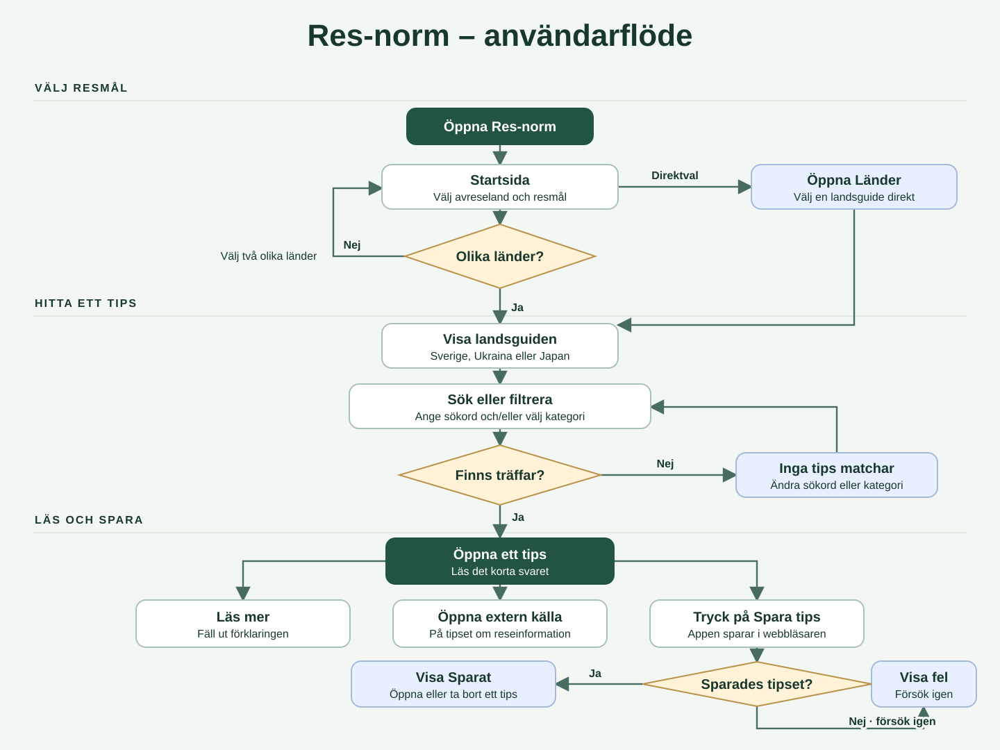

# Apputvecklingsprojekt

**[Öppna Res-norm på GitHub Pages](https://dante09999.github.io/Apputvecklingsprojekt/)**
Apputvecklingsprojek i Teknik 1
# Res-norm-app
### Område: 
Resor och kultur.

### Problem: 
När jag reser till ett annat land kan det vara svårt att veta vilka sociala vanor och regler som skiljer sig från dem jag är van vid hemma. Om jag till exempel blir hembjuden till någon i Ukraina kanske jag undrar om det är vanligt att ta med en liten gåva. Sådana frågor kan kännas enkla, men det kan ta tid att hitta ett tydligt svar när informationen finns utspridd på olika webbplatser.

### App-lösning: 
Res-norm-appen hjälper resenärer att snabbt läsa på inför vanliga situationer. Användaren väljer vilket land hen reser från och vilket land hen ska besöka. Sedan kan hen välja en kategori, till exempel Hemma hos någon, På restaurang eller Hälsa och bemötande. Om jag väljer Sverige → Ukraina kan jag till exempel öppna Hemma hos någon och läsa om vad jag kan tänka på inför ett besök.

Varje tips börjar med ett kort svar och följs av en förklaring. Appen visar när en vana kan variera mellan familjer eller regioner. Information om lokala regler och lagar finns under Regler och lagar, där varje artikel länkar till en officiell källa och visar när informationen kontrollerades.

### Målgrupp

Appen riktar sig till personer som reser utomlands och vill känna sig tryggare i vardagliga möten, särskilt de som besöker ett land för första gången. En resenär kan använda appen hemma inför resan eller i mobilen precis innan ett restaurangbesök eller en middag. Därför har appen korta texter, tydliga kategorier och en knapp för att spara tips så att de går att läsa utan internet.

### UI/UX Design

### Flödesschema

